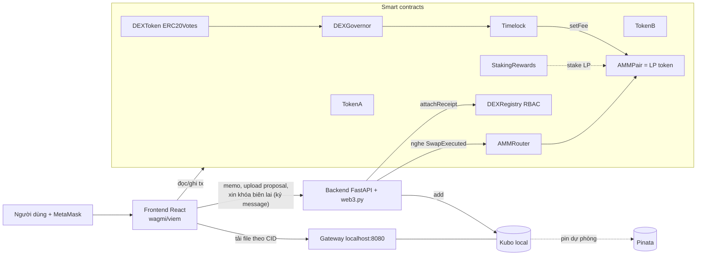

# Kiến trúc hệ thống - AMM DEX

> Trạng thái: **Draft v0.3** (2026-11-12). Interface ở mục 4 cần chốt trước **2026-11-15** để các nhánh làm song song.
> Nguồn yêu cầu: [`README.md`](../README.md) (yêu cầu riêng của đề) và [`rubric.md`](../rubric.md) (rubric chung). Mỗi tiêu chí phải đạt **cả hai**.
> Thay đổi so với v0.1: xem [mục 15](#15-lịch-sử-thay-đổi).

## Tóm tắt dễ hiểu

**Bài toán.** Trên sàn tập trung, người dùng phải gửi tiền cho sàn giữ hộ. Nếu sàn gian lận, bị hack hay phá sản thì người dùng mất tiền. Đây là "rủi ro đối tác". Nhóm xây một sàn đổi token **phi tập trung**, trong đó không ai giữ hộ tiền của ai.

**Cách sàn hoạt động.** Thay cho sổ lệnh mua bán, sàn có một "bể" chứa hai loại token A và B.

- **Người góp vốn** bỏ cả hai loại token vào bể và nhận một "giấy chứng nhận góp vốn" (LP token).
- **Người giao dịch** bỏ A vào bể và lấy B ra. Giá do một công thức cố định tự tính: bể càng ít B thì B càng đắt.
- Mỗi lượt đổi trả một khoản phí nhỏ (0,3%). Phí ở lại trong bể, nên giấy chứng nhận của người góp vốn ngày càng có giá trị hơn.
- Mọi luật lệ nằm trong **hợp đồng thông minh** trên blockchain. Không ai sửa được luật hay rút tiền của người khác. Người dùng tự ký mọi giao dịch bằng ví MetaMask của mình.

**Các phần của hệ thống:**

| Phần | Vai trò |
|---|---|
| Hợp đồng thông minh | "Bộ luật" của sàn: bể thanh khoản, đổi token, góp và rút vốn, thưởng cho người gửi giấy chứng nhận (staking), bỏ phiếu đổi mức phí (governance), phân quyền |
| Website | Nơi người dùng đổi token, góp vốn, xem thống kê của bể, bỏ phiếu |
| Máy chủ phụ trợ | Tự lập "phiếu giao dịch" cho các giao dịch lớn, mã hóa phiếu, cấp quyền xem phiếu |
| IPFS (kho lưu trữ phi tập trung) | Lưu danh sách token và logo, phiếu giao dịch đã mã hóa, tài liệu đề xuất đổi phí |

**Những điểm làm nên giá trị của sản phẩm:**

- Người dùng luôn giữ quyền kiểm soát tiền của mình.
- Giá minh bạch, tính bằng công thức ai cũng kiểm chứng được.
- Người góp vốn được trả phí tự động.
- Cộng đồng biểu quyết mức phí, và mức phí bị giới hạn trần.
- Chỉ người có quyền mới xem được phiếu giao dịch.

**Phạm vi.** Một bể duy nhất cho cặp TokenA/TokenB. Chạy trên máy của nhóm để demo, có bản triển khai trên mạng thử nghiệm Sepolia làm minh chứng. Không dùng tiền thật.

Phần còn lại của tài liệu là thiết kế kỹ thuật chi tiết.

## 1. Quyết định đã chốt

| # | Hạng mục | Chốt | Lý do ngắn |
|---|---|---|---|
| D1 | Ngôn ngữ contract | Solidity (^0.8.x), OpenZeppelin v5 | Đúng chữ README; có sẵn ERC20, AccessControl, Governor |
| D2 | AMM | Tự viết, mô hình Uniswap V2 rút gọn (Core `AMMPair` + `AMMRouter`) | Hiểu từng dòng để phản biện; README yêu cầu Core + Router |
| D3 | Phạm vi pool | 1 pool TokenA/TokenB. `AMMPair` tổng quát (token0/token1 qua constructor) | Giảm rủi ro; Factory là điểm cộng tuần 4 |
| D4 | Toolchain | Foundry (forge test, fuzz/invariant, Anvil, forge script) | Nhanh, có fuzz/invariant để chứng minh `k` không giảm |
| D5 | Frontend | React + Vite + wagmi + viem + RainbowKit (chỉ connector MetaMask/injected) | Xử lý sẵn ví/mạng/trạng thái tx, có `simulateContract` |
| D6 | Backend | Python FastAPI + web3.py | Đúng chữ "Web3.py"; giữ khóa ở server; nghe event |
| D7 | IPFS | **Kubo local là đường chính** (gateway `localhost:8080`); Pinata là bản sao dự phòng, best-effort | Demo không phụ thuộc mạng; link vẫn mở được khi laptop tắt |
| D8 | Mã hóa | Biên lai JSON: AES-256-GCM, khóa `K = HKDF(masterKey, txHash)`; `K` bọc RSA-OAEP cho Auditor, giải mã bằng CLI | Thỏa "RSA, AES" của rubric; ít code; không đưa private key vào trình duyệt |
| D9 | Governance | Contract: OpenZeppelin Governor + ERC20Votes + TimelockController (sinh bằng OZ Wizard). UI rút gọn | Chuẩn DeFi, chống vote 2 lần; UI vừa sức |
| D10 | Chain | Demo trên Anvil local (`--block-time 2`, lưu state); deploy + verify trên Sepolia làm minh chứng | Rubric TC1 bắt buộc testnet; demo local để không phụ thuộc mạng |
| D11 | Phí swap | 0.30% (30 bps) mặc định, giữ lại trong pool, đổi được qua governance, trần 1% | Fee Collection tự động cho LP; trần chống governance lạm dụng |
| D12 | Frontend | 4 trang: Swap, Pool, Governance, History & Receipts | Vừa sức ~2.5 tuần code |

## 2. Tổng quan



**Non-custodial:**

- Người dùng chỉ `approve` cho Router (hoặc StakingRewards) **đúng số token cần**; private key luôn ở MetaMask.
- **Không contract nào có hàm cho admin rút tài sản của pool hoặc của người stake.** Không chép hàm `recoverERC20` của Synthetix.
- Đổi phí chỉ đi qua Timelock và bị giới hạn bởi trần 1%.
- Ai giữ quyền gì: xem bảng ở mục 4.8.
- Ngoại lệ phải nói rõ trong báo cáo: TokenA/TokenB là **token thử nghiệm**. Owner chỉ mint trong lúc seed rồi renounce. Faucet vẫn mở, nên ai cũng có thể lấy token thử để mua cạn pool. Đây là đặc tính của môi trường test, không phải của DEX.

Đây là luận điểm "giải quyết Counterparty Risk" (Chương 10) cho báo cáo.

## 3. Toán AMM

Ký hiệu: `rIn, rOut` là reserve trước swap, `f` là phí theo bps (đọc `pair.feeBps()` tại thời điểm gọi, **không** hard-code).

**Swap (exact input):**

```
amountInWithFee = amountIn * (10000 - f)
amountOut       = amountInWithFee * rOut / (rIn * 10000 + amountInWithFee)
```

**Trong Pair:**

- Lượng vào được suy từ số dư: `amount0In = balance0 > r0 - amount0Out ? balance0 - (r0 - amount0Out) : 0`, tương tự cho token1.
- Bắt buộc `amount0In > 0 || amount1In > 0`.
- k-check có phí:
  `b0Adj = balance0 * 10000 - amount0In * f`, tương tự `b1Adj`
  `require(b0Adj * b1Adj >= r0 * r1 * 10000**2)`

**Giá và price impact:**

- Giá spot: `rOut / rIn`.
- **Price impact** = `1 - (amountOut / amountInAfterFee) / (rOut / rIn)`. Frontend hiển thị phí và impact tách riêng.

**Mint LP:**

- Lần đầu: `sqrt(a*b) - MINIMUM_LIQUIDITY` (dùng `Math.sqrt` của OZ). 1000 LP được mint tới `address(0xdead)` để chống inflation attack; OZ v5 không cho mint tới `address(0)`.
- Các lần sau: `min(a*S/rA, b*S/rB)`.
- Bắt buộc `liquidity > 0`.

**Burn LP:** nhận `lp * balance / S` mỗi token.

**Fee Collection:**

- Phí đọng lại trong pool làm `sqrt(k)/totalSupply`, tức giá trị mỗi LP token đo bằng `k`, **tăng sau mỗi swap**.
- LP được trả phí qua việc mỗi LP token đổi được nhiều hơn.
- Lưu ý: điều này **không** có nghĩa LP luôn rút về nhiều token hơn lúc nạp. Khi giá biến động, impermanent loss có thể làm một phía, hoặc tổng giá trị, nhỏ hơn. Phí chỉ bù một phần.
- Pair ghi thêm bộ đếm `feeAccrued0/1` để **hiển thị** được phần phí này (mục 4.2, 7).

**Kiểm tra thanh khoản:**

- Với `rIn > 0` thì theo công thức luôn có `amountOut < rOut`, tức pool **không bao giờ bị rút cạn** bằng swap exact input.
- Ràng buộc `InsufficientLiquidity` vẫn được giữ, nhằm phòng thủ khi:
  - pool rỗng (chưa có thanh khoản);
  - có lệnh gọi thẳng `pair.swap` với `amountOut >= reserve`.
- Demo ràng buộc này bằng swap trên pool rỗng (forge test và một bước trong kịch bản trước khi seed) và giải thích lý do toán học.

**Làm tròn:** mọi phép chia làm tròn xuống, có lợi cho pool. Nếu sau này thêm `getAmountIn` (exact output) thì phải làm tròn lên.

**Tràn số:** reserve là `uint256`. Phép `b0Adj*b1Adj` chỉ tràn (và revert) khi mỗi phía vượt khoảng 1e33 token 18-decimals, xa hơn nhiều so với cung của token test. Uniswap V2 dùng `uint112` để chặn cứng; ở đây ghi nhận như một giới hạn.

**Giới hạn:** không hỗ trợ token fee-on-transfer/rebasing.

## 4. Smart contracts (interface cần chốt)

Tất cả token 18 decimals. Revert dùng custom error. Role là `bytes32 public constant X_ROLE = keccak256("X_ROLE");`.

### 4.1 `TestToken` (TokenA "TKA", TokenB "TKB")

ERC20 + Ownable.

```solidity
constructor(string memory name, string memory symbol, address initialOwner)  // Ownable(initialOwner)
function mint(address to, uint256 amount) external onlyOwner   // chỉ dùng lúc seed, sau đó renounceOwnership()
function faucet() external                                      // 1.000 token / địa chỉ / 24h
event FaucetClaimed(address indexed user, uint256 amount);
error FaucetCooldown(uint256 availableAt);
```

### 4.2 `AMMPair` (Core, đồng thời là LP token "AMM-LP")

ERC20 + AccessControl + ReentrancyGuard. Hàm cấp thấp kiểu V2: token phải được chuyển vào Pair **trước** khi gọi `mint`/`burn`/`swap`; Router lo việc này.

```solidity
bytes32 public constant FEE_SETTER_ROLE = keccak256("FEE_SETTER_ROLE");
uint256 public constant MINIMUM_LIQUIDITY = 1000;
uint16  public constant MAX_FEE_BPS = 100;
address public immutable token0;
address public immutable token1;
uint16  public feeBps;                        // khởi tạo 30
uint256 public feeAccrued0;                   // tổng phí token0 đã thu
uint256 public feeAccrued1;                   // tổng phí token1 đã thu

constructor(address token0, address token1, address admin)   // admin = Timelock; cấp DEFAULT_ADMIN + FEE_SETTER

function getReserves() external view returns (uint256 r0, uint256 r1);
function mint(address to) external nonReentrant returns (uint256 liquidity);
function burn(address to) external nonReentrant returns (uint256 amount0, uint256 amount1); // burn LP đang nằm trong Pair
function swap(uint256 amount0Out, uint256 amount1Out, address to) external nonReentrant;
function setFee(uint16 newFeeBps) external onlyRole(FEE_SETTER_ROLE);

event Mint(address indexed sender, uint256 amount0, uint256 amount1, address indexed to);
event Burn(address indexed sender, uint256 amount0, uint256 amount1, address indexed to);
event Swap(address indexed sender, uint256 amount0In, uint256 amount1In,
           uint256 amount0Out, uint256 amount1Out, address indexed to);
event Sync(uint256 reserve0, uint256 reserve1);
event FeeUpdated(uint16 oldFeeBps, uint16 newFeeBps);

error InvalidOutputAmounts();          // swap: cả hai amountOut = 0, hoặc cả hai > 0
error InsufficientLiquidity();         // pool rỗng hoặc amountOut >= reserve
error InvalidTo();                     // to là token0 hoặc token1
error InsufficientInputAmount();       // không có token vào
error KInvariant();                    // không qua k-check (có tính phí)
error InsufficientLiquidityMinted();   // mint ra 0 LP
error InsufficientLiquidityBurned();   // burn ra 0 token
error FeeTooHigh(uint16 newFeeBps);    // setFee vượt MAX_FEE_BPS
```

**Ràng buộc trong `swap`:**

- Có đúng một chiều ra, với `amountOut > 0` (`InvalidOutputAmounts()`).
- **`amount0Out < r0 && amount1Out < r1`** (kiểm tra thanh khoản, `InsufficientLiquidity()`).
- `to` khác token0/token1 (`InvalidTo()`).
- Có token vào (mục 3, `InsufficientInputAmount()`) và qua được k-check (`KInvariant()`).

Sau mỗi swap: `feeAccrued += amountIn * feeBps / 10000`, cập nhật reserve, emit `Sync`.

**Lưu ý:** `Swap.sender` là **Router**, không phải người dùng. Danh tính trader lấy từ event `SwapExecuted` của Router (mục 4.3).

### 4.3 `AMMRouter` (định tuyến)

Tên hàm khớp README: `addLiquidity`, `swapTokens`, `removeLiquidity`. Router không giữ tiền, chỉ chuyển token từ người dùng thẳng vào Pair bằng `SafeERC20.safeTransferFrom`.

```solidity
constructor(address pair)

function addLiquidity(uint256 amountADesired, uint256 amountBDesired,
    uint256 amountAMin, uint256 amountBMin, address to, uint256 deadline)
    external returns (uint256 amountA, uint256 amountB, uint256 liquidity);

function swapTokens(address tokenIn, uint256 amountIn, uint256 amountOutMin,
    address to, uint256 deadline) external returns (uint256 amountOut);

function removeLiquidity(uint256 liquidity, uint256 amountAMin, uint256 amountBMin,
    address to, uint256 deadline) external returns (uint256 amountA, uint256 amountB);
    // cần approve LP cho Router trước

// view cho frontend
function getAmountOut(address tokenIn, uint256 amountIn) external view returns (uint256);
function quote(uint256 amountA, uint256 reserveA, uint256 reserveB) external pure returns (uint256);

event SwapExecuted(address indexed trader, address indexed tokenIn, address tokenOut,
    uint256 amountIn, uint256 amountOut, uint256 feeAmount,
    uint256 reserveInBefore, uint256 reserveOutBefore, address to);
    // feeAmount tính bằng tokenIn: amountIn * feeBps / 10000
```

`SwapExecuted` chứa đủ dữ liệu cho backend (trader = `msg.sender`, reserve trước swap để xét "giao dịch lớn") và trang History, không cần đọc state lịch sử.

**Ràng buộc logic (TC1):**

| Ràng buộc | Vị trí | Lỗi |
|---|---|---|
| Hết hạn | mọi hàm ghi | `Expired()` nếu `block.timestamp > deadline` |
| **Slippage swap** | `swapTokens` | `InsufficientOutput()` nếu `amountOut < amountOutMin` |
| Slippage thanh khoản | add/remove | `InsufficientAAmount()` / `InsufficientBAmount()` |
| **Đủ thanh khoản** | `getAmountOut`, `AMMPair.swap` | `InsufficientLiquidity()`: pool rỗng hoặc `amountOut >= reserve` (xem mục 3) |
| Số lượng hợp lệ | mọi hàm ghi | `ZeroAmount()` |
| Token hợp lệ | `swapTokens` | `InvalidToken()` nếu `tokenIn` không thuộc pair |

`addLiquidity` tính lượng tối ưu theo tỷ lệ reserve hiện tại (như V2): chỉ lấy đúng tỷ lệ, phần dư không bị lấy.

### 4.4 `DEXToken` ("DEX" - token thưởng + quyền biểu quyết)

ERC20 + ERC20Permit + ERC20Votes. Override bắt buộc trong OZ v5: `_update(...) override(ERC20, ERC20Votes)` và `nonces(...) override(ERC20Permit, Nonces)`.

**Cung cố định 1.000.000 DEX** mint cho deployer khi deploy; không có hàm mint. Phân bổ lúc seed:

| Nơi nhận | Tỷ lệ | Ghi chú |
|---|---|---|
| `StakingRewards` | 40% | Thưởng farming |
| Timelock (kho bạc) | 30% | Không delegate nên không tham gia vote |
| Ví LP, Trader, Community | 10% mỗi ví | Ba ví độc lập để demo vote có phe thuận và phe chống |

Holder phải `delegate(self)` **trước khi** proposal được tạo thì mới có quyền vote. Seed delegate sẵn cho ví LP và Trader; ví Community delegate trực tiếp trong demo để minh họa bước này. Frontend có nút "Kích hoạt quyền biểu quyết".

### 4.5 `StakingRewards` (Yield Farming)

Mô hình Synthetix: stake LP token, nhận DEX theo thời gian, tỷ lệ theo phần stake.

```solidity
bytes32 public constant REWARD_DISTRIBUTOR_ROLE = keccak256("REWARD_DISTRIBUTOR_ROLE");
constructor(address stakingToken /*AMMPair*/, address rewardToken /*DEX*/, address admin /*Timelock*/, address distributor)

function stake(uint256 amount) public nonReentrant;      // cần approve LP cho StakingRewards
function withdraw(uint256 amount) public nonReentrant;
function getReward() public nonReentrant;
function exit() external;                                // gọi _withdraw(all) + _getReward() nội bộ
function earned(address account) external view returns (uint256);
function rewardRate() external view returns (uint256);   // DEX / giây
function periodFinish() external view returns (uint256);
function totalSupply() external view returns (uint256);  // tổng LP đang stake
function balanceOf(address account) external view returns (uint256);
function stakingToken() external view returns (address);
function rewardToken() external view returns (address);
function notifyRewardAmount(uint256 reward, uint256 duration) external onlyRole(REWARD_DISTRIBUTOR_ROLE);

event Staked(address indexed user, uint256 amount);
event Withdrawn(address indexed user, uint256 amount);
event RewardPaid(address indexed user, uint256 reward);
event RewardAdded(uint256 reward, uint256 duration);

error ZeroAmount();                              // stake/withdraw 0, hoặc reward/duration = 0
error InsufficientStake();                       // withdraw nhiều hơn đang stake
error RewardPeriodActive(uint256 periodFinish);  // notify khi kỳ cũ chưa kết thúc
error InsufficientRewardBalance();               // không giữ đủ DEX cho rewardRate * duration
```

**Ràng buộc của `notifyRewardAmount`:**

- Chỉ gọi khi `block.timestamp >= periodFinish`, không cộng dồn giữa kỳ, để đơn giản.
- Contract phải đang giữ đủ DEX cho `rewardRate * duration`.

### 4.6 `DEXGovernor` + `TimelockController`

**Sinh `DEXGovernor` bằng [OpenZeppelin Contracts Wizard](https://wizard.openzeppelin.com/#governor)** với bộ: Settings, CountingSimple, Votes, QuorumFraction, TimelockControl. Không viết override bằng tay.

Clock của ERC20Votes mặc định là `block.number`, nên mọi tham số tính theo **block**.

| Tham số | Anvil (block 2s) | Sepolia (~12s/block) |
|---|---|---|
| votingDelay | 1 block | 1 block |
| votingPeriod | 30 block (~60 giây) | 25 block (~5 phút) |
| proposalThreshold | 1.000 DEX | 1.000 DEX |
| quorum | 4% tổng cung (40.000 DEX) | 4% |
| Timelock minDelay | 60 giây | 120 giây |

Mốc thời gian:

- Vote mở từ block **propose + 2**: snapshot = `proposeBlock + votingDelay`, và trạng thái chỉ thành Active khi `block > snapshot`.
- Vòng đầy đủ trên Anvil mất khoảng 2.5 phút: propose → vote → queue → chờ 60s → execute.
- Script `scripts/chain.sh skip` (`anvil_mine`, `evm_increaseTime` + `evm_mine`) dùng khi cần rút ngắn.
- Cần test biên này bằng forge.

**Luồng đề xuất đổi phí:**

1. Proposer soạn tài liệu **PDF** → upload qua backend → nhận `CID`.
2. `governor.propose([pair], [0], [abi.encodeCall(AMMPair.setFee, (newBps))], description)`, với `description = "# <Tiêu đề>\n\nipfs://<CID>"`.
3. Holder đã delegate vote For/Against/Abstain. Kịch bản demo: LP và Community chọn For, Trader chọn Against.
4. Thành công → `queue` vào Timelock → chờ `minDelay` → `execute` → `FeeUpdated`.
   - `queue`/`execute` cần `keccak256(bytes(description))` của **đúng chuỗi gốc**.
   - Frontend lấy chuỗi này từ event `ProposalCreated`, không tự dựng lại.

**Thứ tự cấu hình** (trong `Deploy.s.sol`):

1. Deploy Timelock (admin tạm = deployer).
2. Deploy Governor.
3. Cấp `PROPOSER_ROLE` và `CANCELLER_ROLE` cho Governor, `EXECUTOR_ROLE` cho `address(0)`.
4. Deployer renounce `DEFAULT_ADMIN_ROLE` của Timelock.

### 4.7 `DEXRegistry` (RBAC cho tài nguyên IPFS)

AccessControl. Lưu con trỏ CID on-chain; đây là chỗ kiểm soát **ghi** và nguồn sự thật về **quyền đọc** biên lai.

```solidity
bytes32 public constant TOKEN_LIST_MANAGER_ROLE = keccak256("TOKEN_LIST_MANAGER_ROLE");
bytes32 public constant RECEIPT_ISSUER_ROLE     = keccak256("RECEIPT_ISSUER_ROLE");  // ví backend
bytes32 public constant AUDITOR_ROLE            = keccak256("AUDITOR_ROLE");

struct Receipt { string cid; address trader; uint64 timestamp; }

constructor(address admin)

function tokenListCID() external view returns (string memory);
function tokenListVersion() external view returns (uint256);
function setTokenList(string calldata cid) external onlyRole(TOKEN_LIST_MANAGER_ROLE);

function attachReceipt(bytes32 txHash, address trader, string calldata cid) external onlyRole(RECEIPT_ISSUER_ROLE);
function getReceipt(bytes32 txHash) external view returns (Receipt memory);
function receiptsOf(address trader) external view returns (bytes32[] memory);

event TokenListUpdated(uint256 indexed version, string cid);
event ReceiptAttached(bytes32 indexed txHash, address indexed trader, string cid);
```

Ràng buộc: `attachReceipt` không ghi đè biên lai đã có (`ReceiptExists()`); `cid` không rỗng (`EmptyCID()`).
`getReceipt` của `txHash` chưa có biên lai trả struct rỗng (`cid == ""`), không revert; frontend coi `cid` rỗng là "chưa có biên lai".

### 4.8 Ai giữ quyền gì

Ví demo dùng các tài khoản mặc định của Anvil: #0 Admin/Deployer, #1 LP, #2 Trader, #3 Community, #4 Auditor, #5 Backend.

| Contract | Quyền | Trong lúc deploy/seed | Sau khi seed |
|---|---|---|---|
| TokenA/TokenB | `owner` (mint) | Deployer | **Renounce** (chỉ còn faucet) |
| AMMPair | `DEFAULT_ADMIN`, `FEE_SETTER` | Timelock (cấp trong constructor) | Timelock |
| StakingRewards | `DEFAULT_ADMIN` | Timelock | Timelock |
| StakingRewards | `REWARD_DISTRIBUTOR` | Deployer (để nạp kỳ thưởng đầu) + Timelock | Deployer **renounce**; còn Timelock |
| Timelock | `PROPOSER`, `CANCELLER` | Governor | Governor |
| Timelock | `EXECUTOR` | `address(0)` = ai cũng được | như cũ |
| Timelock | `DEFAULT_ADMIN` | Deployer | **Renounce** |
| DEXRegistry | `DEFAULT_ADMIN` | Ví Admin (#0) | Ví Admin (#0)* |
| DEXRegistry | `TOKEN_LIST_MANAGER` | Ví Admin (#0) | Ví Admin (#0) |
| DEXRegistry | `RECEIPT_ISSUER` | Ví Backend (#5) | Ví Backend (#5) |
| DEXRegistry | `AUDITOR` | chưa cấp | Cấp/thu hồi **trực tiếp trong demo** cho ví #4 |
| DEXToken, DEXGovernor | không có role admin | - | - |

\* Registry không giữ tài sản. Admin của Registry là ví riêng (không phải Timelock) để demo cấp/thu hồi role trong vài giây. Bản production nên chuyển cho Timelock (ghi trong báo cáo).

## 5. IPFS và phân quyền

IPFS là mạng công khai: ai có CID đều tải được file. Vì vậy:

- **Kiểm soát ghi (RBAC):** con trỏ CID chỉ được ghi lên chain bởi đúng role trong `DEXRegistry`.
- **Kiểm soát đọc (RBAC + mã hóa):** biên lai được mã hóa. Khóa chỉ được cấp cho trader của giao dịch hoặc ví có `AUDITOR_ROLE`, kiểm tra on-chain.
- **Chống spam (không phải RBAC):**
  - Backend chỉ nhận upload proposal từ ví có votes ≥ `proposalThreshold`.
  - Bản thân `Governor.propose` cũng đòi ngưỡng này.
  - Ai cũng có thể tự đưa file lên IPFS ở nơi khác.

| Dữ liệu | Định dạng | Ai upload | Con trỏ on-chain | Ai đọc được |
|---|---|---|---|---|
| **Token List** | JSON chuẩn [Uniswap Token Lists](https://tokenlists.org) | `TOKEN_LIST_MANAGER` qua script admin | `Registry.setTokenList(cid)` | Công khai |
| **Logo token** | Ảnh PNG/SVG | cùng script trên | `logoURI` trong Token List | Công khai |
| **Trade Receipt** | JSON, được mã hóa | Backend (`RECEIPT_ISSUER`), tự động | `Registry.attachReceipt(txHash, trader, cid)` | Trader của giao dịch + `AUDITOR` |
| **Governance Proposal** | **PDF** (chỉ nhận PDF) | Holder có votes ≥ threshold, qua backend | Mô tả proposal trong `Governor` | Công khai |

Đủ 3 loại dữ liệu của rubric: **JSON** (token list, biên lai), **ảnh** (logo), **PDF** (proposal).

**Link hiển thị:**

- Demo: `http://localhost:8080/ipfs/<CID>` (gateway của Kubo).
- Báo cáo: `https://<pinata-gateway>/ipfs/<CID>`.
- Không dùng `ipfs://` làm link bấm được, vì trình duyệt không mở được nếu thiếu plugin. `ipfs://` chỉ dùng làm định danh trong JSON/description.

Token list: `logoURI = ipfs://<CID logo>`. Frontend đọc `Registry.tokenListCID()`, tải JSON qua gateway, rồi hiển thị token kèm logo.

### 5.1 Biên lai giao dịch lớn

**"Giao dịch lớn":** `amountIn * 10000 >= LARGE_TRADE_BPS * reserveInBefore`. Mặc định `LARGE_TRADE_BPS = 200` (2%), cấu hình trong backend. Kịch bản demo với pool 10.000/10.000:

- swap 50 TKA (0,5%): không tạo biên lai;
- swap 500 TKA (5%): tạo biên lai, có dư biên an toàn so với ngưỡng.

**Memo riêng** là lý do thực sự để mã hóa:

- Ô Swap có trường "Ghi chú đối soát" (tùy chọn), ví dụ số hóa đơn hoặc đối tác. Đây là dữ liệu **off-chain, không có trên blockchain**.
- Sau khi gửi tx và có `txHash`, frontend POST memo kèm chữ ký lên backend. Backend giữ memo đến khi tạo biên lai.

**Upload (tự động):**

1. Listener đọc `SwapExecuted` (đã có trader, reserve trước swap) và đợi 1 block xác nhận.
2. Nếu là giao dịch lớn, chờ memo tối đa 10 giây rồi tạo `receipt.json`, gồm:
   - txHash, block, thời gian, trader;
   - tokenIn/Out, amountIn/Out;
   - giá thực hiện, price impact, phí;
   - reserve trước/sau;
   - **memo**.
3. `K = HKDF-SHA256(SERVER_MASTER_KEY, salt=txHash, info="receipt-v1")`. Mã hóa AES-256-GCM với IV ngẫu nhiên 12 byte.
4. `wrapAuditor = RSA-OAEP-SHA256(auditorPublicKey, K)`.
5. Upload lên Kubo envelope:
   `{v:1, alg:"AES-256-GCM", iv, ciphertext, wrapAuditor, meta:{txHash, chainId, timestamp}}`.
   Sau đó gọi `attachReceipt(txHash, trader, cid)`, rồi pin bản sao lên Pinata (không chặn luồng chính nếu lỗi).

**Retrieve:**

- **Trong app (trader hoặc auditor), trang History & Receipts:**
  1. Mỗi txHash có biên lai hiện nút "Xem phiếu" và link gateway.
  2. Frontend lấy CID từ `Registry.getReceipt(txHash)` rồi tải envelope.
  3. `GET /auth/nonce` lấy nonce một lần do server cấp, sống 5 phút.
  4. Ví ký message kiểu SIWE (EIP-4361 rút gọn), gồm domain, chainId, txHash, nonce, expiry.
  5. `POST /receipts/key`: backend khôi phục địa chỉ, rồi đối chiếu `== Registry.getReceipt(txHash).trader` hoặc `Registry.hasRole(AUDITOR_ROLE, addr)`. Đánh dấu nonce đã dùng. Trả `K`.
  6. Frontend giải mã bằng Web Crypto (AES-GCM) và hiển thị phiếu dễ đọc.
- **Auditor ngoại tuyến:** `python -m backend.audit_cli decrypt <CID> --key auditor.pem` mở `wrapAuditor` bằng RSA private key (PKCS#8), không cần backend đang chạy. Private key không bao giờ đưa vào trình duyệt.

**Demo RBAC trực tiếp:**

1. Ví #4 xin khóa biên lai của người khác → **403**.
2. Admin `grantRole(AUDITOR_ROLE, #4)` → xin lại → xem được.
3. `revokeRole` → lại bị **403**.

**Giới hạn cần nói thẳng trong báo cáo:**

- Server suy ra được mọi `K`: đây là dịch vụ quản lý khóa có lưu ký, không phải mã hóa đầu-cuối. Lộ `SERVER_MASTER_KEY` thì lộ mọi biên lai.
- Đường RSA không thu hồi được: ai đang giữ private key của Auditor vẫn giải mã được, kể cả sau khi bị revoke role. Mọi auditor dùng chung một cặp khóa.
- Số liệu swap vốn công khai on-chain; phần thật sự cần bảo mật là memo và tài liệu đối soát tổng hợp.
- Khóa `K` đi qua HTTP trên localhost. Production cần TLS.

## 6. Backend (FastAPI + web3.py)

Chạy trên laptop, `localhost:8000`. Ví backend là tài khoản riêng (#5), không trùng ví demo nào.

| Thành phần | Việc |
|---|---|
| `listener` | Poll `SwapExecuted` mỗi 2 giây từ block con trỏ (lưu file; tự reset khi chainId hoặc genesis đổi). Lọc giao dịch lớn, tạo biên lai (mục 5.1) |
| `tx_queue` | Gửi `attachReceipt` **tuần tự** (một tx một lúc) để không trùng nonce |
| `crypto` | HKDF, AES-GCM, RSA-OAEP (thư viện `cryptography`); khôi phục chữ ký (`eth_account`) |
| `ipfs` | Kubo HTTP API (`/api/v0/add`, CIDv1); pin bản sao lên Pinata (best-effort) |
| `GET /auth/nonce` | Cấp nonce một lần, hạn 5 phút |
| `POST /receipts/memo` | Nhận `{txHash, memo, chữ ký}`. Chỉ nhận nếu người ký là `from` của tx |
| `POST /receipts/key` | Kiểm tra chữ ký + quyền on-chain (mục 5.1); trả `K` |
| `POST /proposals/upload` | Nhận file **PDF** + chữ ký. Kiểm tra `DEXToken.getVotes(addr) >= threshold`, upload, trả CID |
| `GET /quote` (tùy chọn) | Báo giá bằng web3.py, dùng để đối chiếu với frontend (khớp chữ "Web3.py" ở README TC2) |
| `GET /health` | Kiểm tra RPC, IPFS, số dư ví backend |
| `scripts/publish_tokenlist.py` | Upload logo + Token List lên Kubo, gọi `Registry.setTokenList` bằng ví Admin |
| `audit_cli.py` | Auditor giải mã biên lai bằng RSA private key |

Bí mật trong `.env` (không commit): `RECEIPT_ISSUER_PRIVATE_KEY`, `SERVER_MASTER_KEY`, `PINATA_JWT`, `AUDITOR_PUBLIC_KEY_PATH`.

## 7. Frontend

4 trang, cùng một header: kết nối ví, cảnh báo sai mạng, nút **Faucet** TKA/TKB.

| Trang | Chức năng | Đọc/Ghi on-chain |
|---|---|---|
| **Swap** | Nhập số lượng, đảo chiều, báo giá realtime, price impact, phí, slippage (mặc định 0.5%), minimum received, ô memo | đọc `getAmountOut` mỗi block; ghi `approve`, `swapTokens` |
| **Pool** | (a) Thêm/rút thanh khoản, LP và phần sở hữu. (b) Dashboard: reserve, giá, `k`, TVL, phí tích lũy, phần thưởng dự kiến. (c) Farm: stake/unstake LP, claim DEX | `addLiquidity`, `removeLiquidity`, `approve` LP, `stake`, `withdraw`, `getReward` |
| **Governance** | Kích hoạt quyền biểu quyết, tạo đề xuất (upload PDF + phí mới), danh sách và trạng thái, vote, nút "Queue + Execute" | Governor, DEXToken |
| **History & Receipts** | Lịch sử swap của ví (từ `SwapExecuted`), link biên lai, xem phiếu đã giải mã | Router events, Registry, gateway, backend |

**Giá chính xác trước khi xác nhận** (README TC2):

1. Báo giá cập nhật theo mỗi block mới.
2. Khi bấm Swap, đọc lại `getAmountOut`. Nếu lệch so với giá đang hiển thị quá slippage thì chặn và yêu cầu xác nhận lại.
3. `simulateContract` trước khi gửi.
4. Gửi với `amountOutMin = quote * (1 - slippage)` và **`deadline = timestamp block mới nhất + 20 phút`**. Không dùng đồng hồ máy, vì chain có thể bị tua thời gian.

**TVL** tính theo đơn vị TokenB, vì token test không có giá USD: `TVL = rB + rA * (rB/rA) = 2 * rB`. Khi thêm Factory với stablecoin giả thì chuyển sang USD.

**Phí và phần thưởng dự kiến cho LP:**

- Phí tích lũy quy về TokenB: `feeB_eq = feeAccrued0 * (rB/rA) + feeAccrued1` (tính theo giá hiện tại).
- `Fee APR (ước tính) = feeB_eq / TVL * (365 ngày / thời gian từ lúc deploy)`. Ghi chú trên UI rằng chain demo có ít dữ liệu nên số này dao động mạnh.
- Phí của bạn (ước tính) = `LP của bạn / S * (feeB_eq hiện tại - feeB_eq lúc bạn nạp)`.
  - Giá trị lúc nạp đọc ở block của event `Mint` (Anvil đọc được state lịch sử).
  - Trên Sepolia thì lưu vào `localStorage` khi nạp.
  - Đây là con số ước tính, vì phần sở hữu thay đổi khi người khác nạp hoặc rút.
- Farming:
  - `earned()` đọc từ contract;
  - "DEX/ngày" = `rewardRate * 86400 * myStake / totalStaked`;
  - giữa hai block, UI nội suy từ `rewardRate`.
  - DEX chưa có giá nên không quy đổi APR.
- **Bằng chứng phí vào pool** (README Workflow): dashboard hiển thị `k`, `sqrt(k)/S` và `feeAccrued` trước và sau mỗi swap.

**Ví:**

- RainbowKit chỉ bật connector MetaMask/injected, không dùng WalletConnect.
- Font và tài nguyên để local.
- Phải thử toàn bộ demo khi **tắt Wi-Fi**.

**Approve:** luôn approve đúng số cần (minh họa non-custodial). Kịch bản demo liệt kê từng lần bấm MetaMask, kể cả approve LP khi rút và khi stake.

**Thư viện:** frontend dùng viem, không dùng Web3.js. Viem là thư viện tương đương Web3.js (JSON-RPC, ABI, ký giao dịch), được wagmi dùng làm nền. Ghi một câu này trong báo cáo.

## 8. Bảo mật

- **Reentrancy:** `ReentrancyGuard` ở Pair và Staking; tuân thủ checks-effects-interactions; dùng `SafeERC20`.
- **Inflation attack:** `MINIMUM_LIQUIDITY` chống tấn công của người nạp đầu.
- **Kế toán theo số dư thực:** dựa trên `balanceOf` và k-check có phí, nên Pair an toàn kể cả khi bị gọi thẳng, không qua Router.
- **Sandwich/MEV:** slippage + deadline giảm rủi ro nhưng không loại bỏ hoàn toàn (nêu trong báo cáo).
- **Đổi phí:** trần `MAX_FEE_BPS = 1%` là lớp bảo vệ chính. Timelock cho người dùng thời gian phản ứng; trên demo thời gian này chỉ mang tính tượng trưng (60s).
- **Non-custodial:** không có hàm rút tiền cho admin; quyền admin xem mục 4.8.
- **Ví backend:** chỉ có `RECEIPT_ISSUER`. Lộ khóa thì kẻ tấn công có thể gắn biên lai giả, hoặc chiếm chỗ biên lai thật vì biên lai không ghi đè được. Tiền người dùng không bị ảnh hưởng.
- **Xác thực chữ ký:**
  - nonce do server cấp, dùng một lần;
  - có hạn dùng;
  - message ràng buộc domain, chainId, txHash;
  - gửi qua POST.
- **Mã hóa:** các giới hạn đã liệt kê ở mục 5.1.

## 9. Kiểm thử

| Loại | Nội dung |
|---|---|
| Unit (forge) | Mỗi hàm và mỗi revert ở mục 4. Luồng add → swap → remove. Swap trên pool rỗng → `InsufficientLiquidity`. `feeAccrued` đúng. Staking reward theo thời gian |
| Fuzz | `getAmountOut` khớp công thức tham chiếu; add rồi remove không mất quá phần làm tròn khi giá không đổi |
| Invariant | `k` không giảm sau swap; **`reserve <= balanceOf`** (vì có thể có người chuyển token thẳng vào Pair); tổng `earned` ≤ reward đã nạp |
| Governance E2E | propose → (biên `votingDelay`) → vote → queue → execute ⇒ `feeBps` đổi. Thiếu quorum → Defeated. `setFee` > 1% → revert |
| Backend (pytest) | Mã hóa khứ hồi; **interop Python ↔ Web Crypto** (AES-GCM, RSA-OAEP-SHA256, PKCS#8); xác thực chữ ký và nonce dùng lại; ngưỡng giao dịch lớn |
| Testnet | `forge script` deploy Sepolia, `forge verify-contract`, lưu `deployments/sepolia.json` (kèm block deploy). **Quay video một luồng đầy đủ** add → swap lớn → biên lai → remove, chạy trước một vòng governance. Chụp link Etherscan cho báo cáo |
| Demo | Thử toàn bộ kịch bản khi tắt Wi-Fi; tập 3 lần |

## 10. Cấu trúc repo và chạy local

```
contracts/      Foundry: src/ test/ script/ (Deploy.s.sol, Seed.s.sol)
frontend/       Vite + React + wagmi
backend/        FastAPI app, listener, crypto, ipfs, audit_cli, scripts/
requirements.txt  thư viện Python (cài vào .venv ở gốc repo)
deployments/    địa chỉ + ABI + block deploy theo chain (anvil.json, sepolia.json)
docs/           ARCHITECTURE.md, demo-script.md, report assets
scripts/dev.sh  khởi động toàn bộ môi trường local
scripts/chain.sh  tiện ích: mine N block, tua thời gian
```

ABI và địa chỉ được export sau mỗi lần deploy vào `deployments/<chain>.json`; frontend và backend đọc file này, không chép tay.

**`scripts/dev.sh`** (thứ tự bắt buộc):

1. `anvil --block-time 2 --state .anvil/state.json` (giữ nguyên địa chỉ và nonce qua các lần khởi động; tránh lỗi nonce của MetaMask).
2. Nếu chưa có `deployments/anvil.json`, hoặc chạy với `--fresh`: `forge script Deploy.s.sol` rồi `Seed.s.sol`. Seed chỉ làm phần on-chain:
   - mint token cho các ví demo;
   - nạp thanh khoản 10.000/10.000;
   - nạp reward vào Staking;
   - phân bổ DEX và delegate;
   - cấp role, rồi renounce.
3. Khởi động Kubo.
4. `python backend/scripts/publish_tokenlist.py` (upload logo + token list, set CID).
5. Khởi động backend.
6. Khởi động frontend.

Khi chạy `--fresh`, xóa state Anvil và nhắc reset tài khoản MetaMask ("Clear activity tab data").

## 11. Đối chiếu yêu cầu

| Yêu cầu | Nguồn | Thành phần |
|---|---|---|
| `addLiquidity`, `swapTokens`, `removeLiquidity` | README TC1 | `AMMRouter` (+ `AMMPair`) |
| Kiểm tra thanh khoản trước swap | README TC1 | `InsufficientLiquidity` (pool rỗng / `amountOut >= reserve`) + giải thích toán (mục 3) + test pool rỗng |
| Slippage hủy giao dịch | README TC1 | `amountOutMin`, `amountAMin/BMin`, `deadline` |
| ≥3 nghiệp vụ, ≥2 ràng buộc | Rubric TC1 | Mục 4.3 (3 nghiệp vụ, 6 ràng buộc) + Staking, Governance |
| Triển khai, kiểm thử testnet | Rubric TC1 | Sepolia + verify + video luồng đầy đủ trên Sepolia |
| Minh họa, giải thích | Rubric TC1 | Mục 3 + báo cáo + NatSpec |
| Swap UI + tỷ giá realtime | README TC2 | Trang Swap |
| Pool Dashboard: TVL + thưởng dự kiến LP | README TC2 | Trang Pool (dashboard + farm) |
| MetaMask | README TC2 | RainbowKit (injected) |
| Giá cập nhật trước khi xác nhận (Web3.js/py) | README TC2 | Mục 7, 4 bước (viem ≈ Web3.js); `/quote` web3.py |
| ≥3 chức năng on-chain | Rubric TC2 | Swap, Liquidity, Farm, Governance, Faucet |
| ≤1 lỗi giao dịch khi demo | Rubric TC2 | `simulateContract`, deadline theo block, state Anvil cố định, kịch bản demo, video dự phòng |
| Mã hóa RSA/AES | Rubric TC2 | Mục 5.1: memo và biên lai AES-256-GCM, khóa bọc RSA-OAEP; giải mã ở frontend |
| Token List, Trade Receipts, Governance Proposals | README TC3 | Mục 5 |
| ≥3 loại dữ liệu | Rubric TC3 | JSON (token list, biên lai), ảnh (logo), PDF (proposal) |
| Upload khi giao dịch lớn; retrieve theo ID giao dịch | README TC3 | Mục 5.1: listener tự động; trang History hiện phiếu theo txHash |
| RBAC | Rubric TC3 | `DEXRegistry`: `TOKEN_LIST_MANAGER`, `RECEIPT_ISSUER`, `AUDITOR` + demo cấp/thu hồi |
| Demo truy xuất thành công | Rubric TC3 | Xem phiếu trong app + mở link gateway + CLI auditor |
| ≥2 token ERC-20 | README TC4 | TokenA, TokenB (+ DEX, LP) |
| LP token mint/burn | README TC4 | `AMMPair.mint/burn` |
| Staking (Yield Farming) | README TC4 | `StakingRewards` |
| Fee Collection | README TC4 | Phí 0.3% giữ trong pool + `feeAccrued` + "phí của bạn" trên dashboard |
| Kiểm thử/demo token | Rubric TC4 | Mục 9 |
| Demo: nạp → swap → thấy phí vào pool | README Workflow | Dashboard: `k`, `sqrt(k)/S`, `feeAccrued` trước/sau |
| Non-custodial, Counterparty Risk | README mục 4 | Mục 2 + bảng quyền 4.8 + báo cáo |
| Không lỗi chính tả | Rubric TC5 | Soát chéo + công cụ kiểm tra chính tả; người biên tập chịu trách nhiệm |
| Số slide, số trang | Rubric TC5 | Chờ yêu cầu của giảng viên (mục 13) |
| Caption hình và bảng | Rubric TC5 | Đánh số "Hình x.y", "Bảng x.y" cho mọi hình và bảng |
| Bảng chữ viết tắt | Rubric TC5 | AMM, DEX, LP, TVL, APR, CID, IPFS, RBAC, AES, RSA, HKDF, ... |
| Tài liệu tham khảo | Rubric TC5 | Danh mục từ README + Uniswap V2 whitepaper, OpenZeppelin docs |
| Cỡ chữ slide > 18, Word > 14 | Rubric TC5 | Template báo cáo và slide đặt sẵn cỡ chữ |
| Tương phản màu | Rubric TC5 | Template nền sáng chữ tối; kiểm tra tỷ lệ tương phản |
| Video demo có caption | Rubric TC5 | Phụ đề cho mọi bước của kịch bản demo |

## 12. Ngoài phạm vi / điểm cộng tuần 4

- **Điểm cộng (tuần 4):**
  - Factory + stablecoin giả + swap nhiều bước.
  - Biểu đồ giá.
  - Báo cáo coverage.
  - CI bằng GitHub Actions.
  - Host frontend trên IPFS.
  - File tổng hợp các giao dịch lớn cho auditor.
  - Reserve `uint112`.
- **Không làm:**
  - Uniswap V3.
  - Flash swap.
  - TWAP oracle.
  - The Graph.
  - Bridge.
  - WalletConnect.

## 13. Câu hỏi mở

1. Frontend dùng TypeScript hay JavaScript? (wagmi có kiểu dữ liệu ABI tốt hơn với TS.)
2. Báo cáo cần bao nhiêu trang/slide (chờ thông tin từ giảng viên)?

## 14. Kiểm chứng trước khi chốt interface (15/11)

- [ ] Sinh `DEXGovernor` bằng OZ Wizard v5. Đối chiếu kiểu tham số của `GovernorSettings` và danh sách override.
- [ ] Forge test biên `votingDelay` (vote mở ở block propose + 2).
- [ ] Compile thử `DEXToken`, `StakingRewards.exit()`, `TestToken` với OZ v5.
- [ ] Chạy RainbowKit chỉ với connector injected khi tắt mạng.
- [ ] So CID giữa Kubo và Pinata cho cùng một file (CIDv1, cùng cách chia khối).
- [ ] Xin Sepolia ETH cho ví deployer và ví backend.

## 15. Lịch sử thay đổi

**v0.3 (2026-11-12)**, khi viết interface (SC-01):

- Đặt tên custom error còn thiếu cho `AMMPair` (4.2) và `StakingRewards` (4.5).
- Thêm getter `stakingToken()`, `rewardToken()` cho `StakingRewards`.
- Ghi rõ đơn vị `SwapExecuted.feeAmount` (tokenIn) và cách `getReceipt` báo chưa có biên lai.

**v0.2 (2026-11-12)**, sau phản biện độc lập:

- Sửa lỗi:
  - trader lấy từ event mới `SwapExecuted` của Router;
  - viết lại câu "LP rút nhiều hơn" (impermanent loss);
  - invariant đổi thành `reserve <= balanceOf`;
  - nói rõ ràng buộc thanh khoản và cách demo;
  - interface đúng với OZ v5 (`Ownable(initialOwner)`, `exit()`, override của `DEXToken`, Governor sinh bằng Wizard, `keccak256` cho role).
- Thêm:
  - `feeAccrued0/1` để Fee Collection hiển thị được;
  - bảng ai giữ quyền gì (4.8);
  - memo riêng trong biên lai;
  - trang xem phiếu đã giải mã;
  - demo RBAC cấp/thu hồi role;
  - các dòng TC5 trong bảng đối chiếu;
  - mục 14.
- Giảm phạm vi:
  - frontend còn 4 trang;
  - UI governance rút gọn;
  - biên lai chỉ JSON;
  - khóa `K` dựng bằng HKDF;
  - auditor giải mã bằng CLI;
  - Kubo là đường chính, Pinata dự phòng;
  - proposal chỉ nhận PDF.
- Giảm rủi ro demo:
  - `anvil --block-time 2` và lưu state;
  - deadline theo timestamp block;
  - tham số governance đủ dài để thuyết minh;
  - backend dùng ví riêng, gửi tx tuần tự;
  - sửa thứ tự `dev.sh` (upload IPFS sau khi Kubo chạy, bằng Python);
  - link gateway HTTP;
  - kiểm tra chạy offline;
  - phiếu demo vượt ngưỡng có dư biên;
  - 3 ví vote độc lập.
